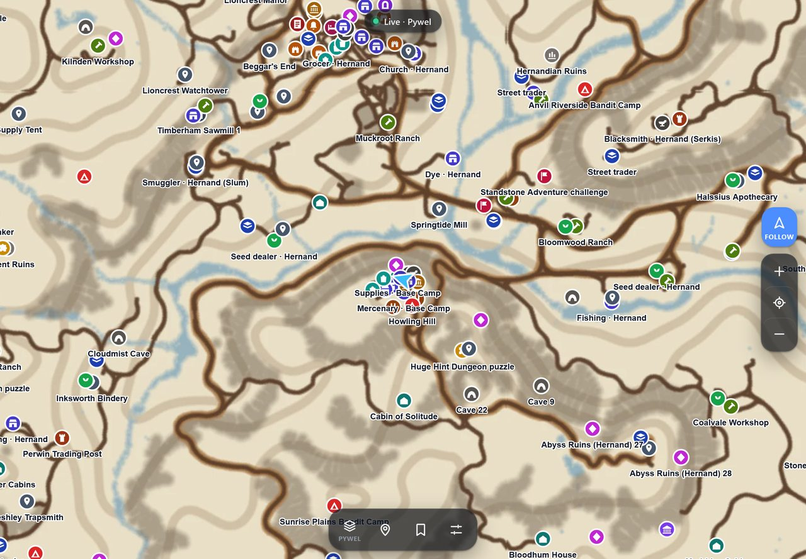
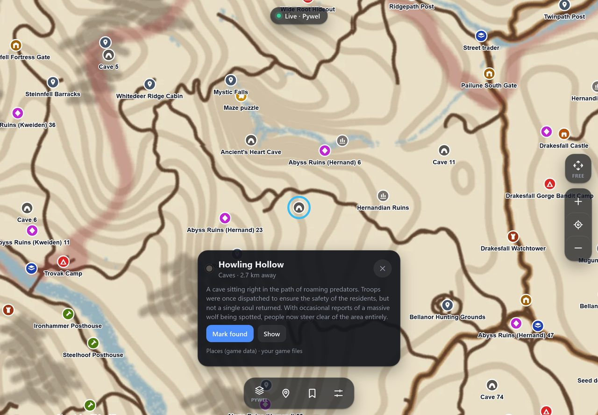
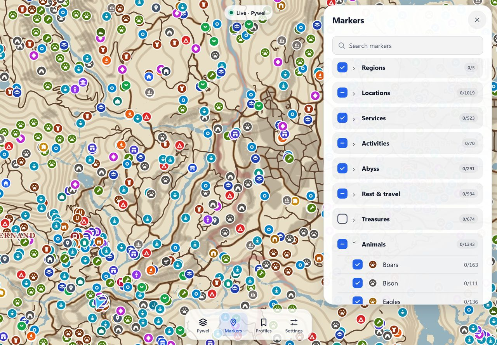
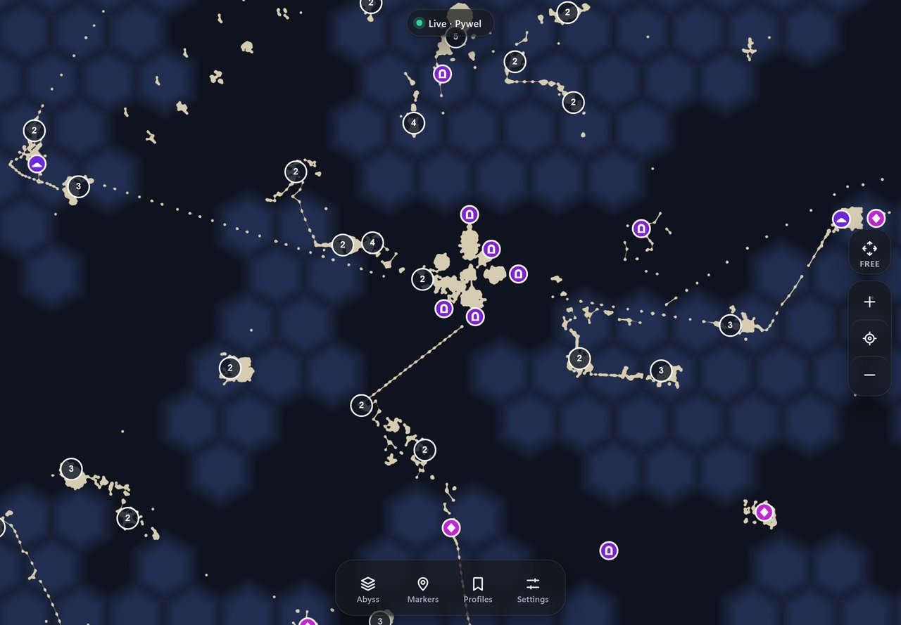
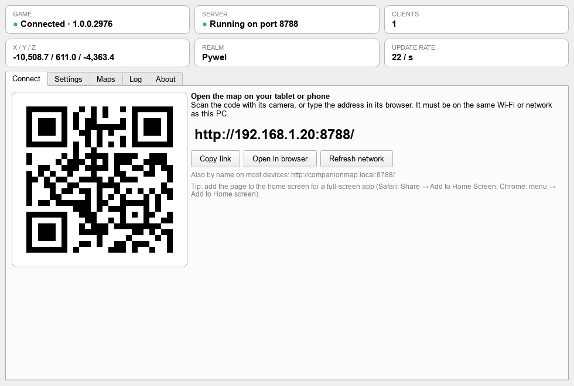
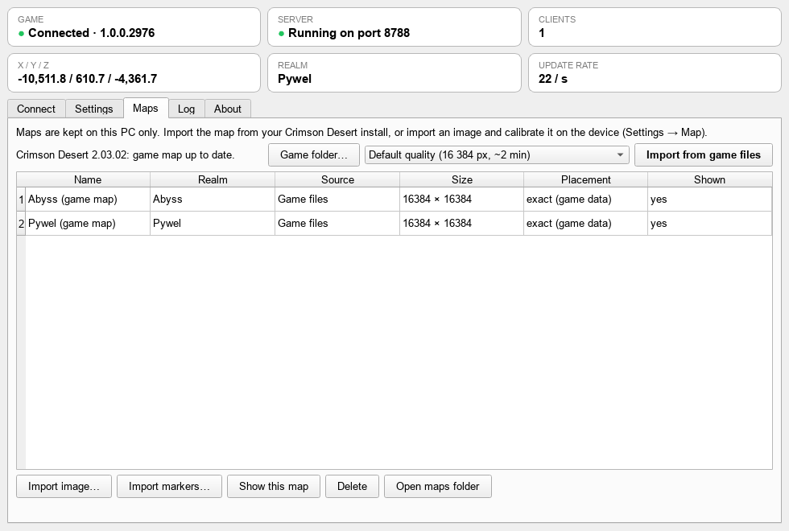
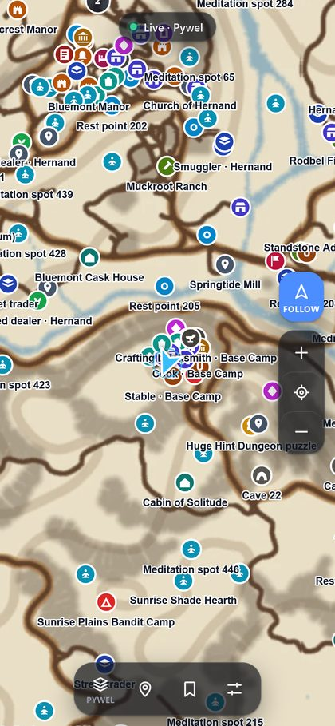
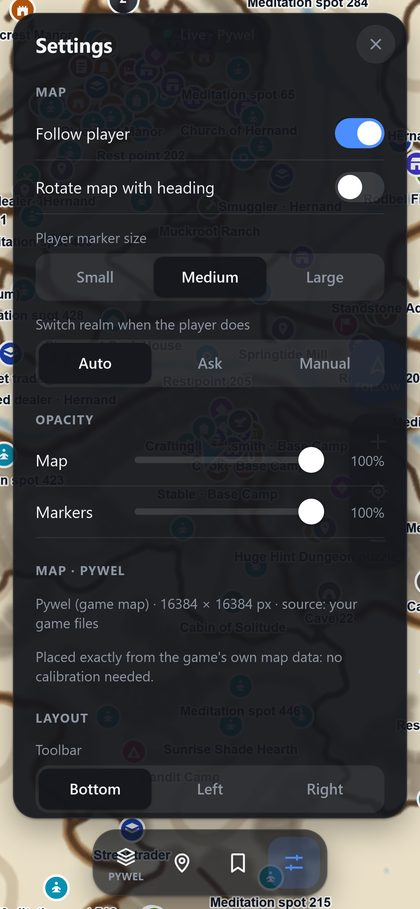

# Offline Companion Map for Crimson Desert

*Companion Map* for short.

*A vibe-coded project, built with the help of [Claude](https://claude.ai), Anthropic's AI.*

A live map for **Crimson Desert** on your tablet or phone, next to the game. A small Windows app
reads where you are in the game and shows it on a map in the device's browser: the arrow moves
and turns with you as you play, with places, shops, Abyss gates and more as markers.

Everything runs on **your own PC and your home network**: your tablet or phone connects **straight to
the PC over your local Wi-Fi or network**. The map is made from your own game install, and the app
doesn't use the internet, online map sites, accounts or telemetry.

> Unofficial fan-made tool, not affiliated with or endorsed by Pearl Abyss. Crimson Desert is a
> trademark of Pearl Abyss Corp. Use at your own risk.



## What you need

- Windows 10 or 11 with Crimson Desert installed (Steam).
  **Tested with game version 2.03.02** (exe 1.0.0.2976, Steam build 25477059), base game, **no DLC**.
  Other versions may need an app update, see *Troubleshooting*.
- A tablet, phone or second computer with a web browser, **on the same Wi-Fi or network as the PC**.
- About 25 MB of disk space for the map (about 45 MB at high resolution).

## Getting started

1. **Get the app**, in one of two ways:
   - **Download the prebuilt release** (easiest): get `CompanionMap-<version>-win64.zip` from the
     [latest release](../../releases/latest), unzip it anywhere and keep the files together. The
     `PySide6` folder next to the exe holds the Qt libraries (LGPLv3), which you may replace with
     compatible builds; see `PySide6/LICENSES/README.txt`.
   - **Build it from source**: see [Building from source](#building-from-source).
2. **Start `CompanionMap.exe`.** Windows asks for administrator rights: the app needs them
   to read the game's memory. It reads only; it never writes player data or changes the game.
3. **Import the map** (once, and again after a game update). Go to the **Maps** tab and click
   **Import from game files**. It takes about 2 minutes (high resolution: about 5).
   - If the game is not in a Steam library, click **Game folder…** and pick the Crimson Desert folder.
   - The map and markers are made from your own install and stay on this PC.
4. **Connect your device over your local network.** On the **Connect** tab, scan the QR code with
   the device's camera, or type the address shown into its browser.
   - On iPhone or iPad, add the page to the home screen (Safari: Share → Add to Home Screen) for a
     full-screen app.
   - Many devices can also open it by name: `http://companionmap.local:8788`.
5. **Play.** The arrow appears as soon as you are in the game world.

If the device cannot connect:

- Make sure both are **on the same local network**.
- Switched Wi-Fi, or turned a VPN on or off? Click **Refresh network** on the Connect tab (the app also
  notices by itself within a few seconds). VPN addresses are never offered; with a VPN on, allow
  *local network access* in the VPN app if devices can't connect.
- Click **Settings → Allow in Windows Firewall**.
- If Windows treats your home Wi-Fi as a *Public* network, the Connect tab says so. Set the network
  to *Private* in Windows network settings.

## Screenshots

| | |
| --- | --- |
|  |  |
| Tap a marker for its name, description and distance, and mark it as found. | Markers in foldable groups; switch categories on and off and search by name. |
|  |  |
| The Abyss, with its islands and bridge routes. | The Windows app: scan the code with your tablet or phone. |
|  |   |
| Import the map from your own game files in a couple of minutes. | Works on phones too: follow or explore freely, zoom, opacity and more. |

*Screenshots show the map made from the game's own map data; the PC address is an example.*

## On the map

- **Follow / Free**: follow the player live, or explore freely. Dragging the map switches to Free.
- **+ / − and the target button**: zoom, and jump back to your position once.
- **Realm button**: switch between Pywel and the Abyss. By default the map follows you between
  realms; a realm you pick by hand stays until you tap Follow.
- **Markers**: show or hide categories by group, search, mark markers as found (shared by every
  device), and add your own markers. You can switch the province names off here.
- **Settings**: rotate the map with your heading, the arrow size, map and marker opacity,
  the theme and the toolbar position.
- **Profiles**: save a layout (zoom, filters, opacity, …) and apply it on any device.

## Secure connection (HTTPS, optional)

The standard `http://` address always works. HTTPS adds one thing: the device can keep its screen
awake while the map is open. To use it:

1. In the app: **Settings → Also serve HTTPS**, then **Apply**.
2. On the **Connect** tab, choose **Secure connection (HTTPS)**.
3. Open the setup page on the device: scan **Show the setup code**, or open
   `http://<PC address>:8788/cdlm/setup`. Then follow the steps to install and trust this PC's
   certificate.
   - On iPhone or iPad: install the profile, then turn on full trust under Settings → General →
     About → Certificate Trust Settings.
4. Open the `https://` address.

The certificate is made on your PC and is limited to local network names and private addresses,
so it cannot be used for any website. You can remove it from the device at any time.

## Your own maps and markers

- **Map images** (screenshots, or downloaded maps whose licence allows it): **Maps → Import
  image…**. Then calibrate the image on the device: Settings → Map → Add point, standing at two or
  more landmarks.
- **Marker files** (CSV, GeoJSON or JSON with game x/z): **Maps → Import markers…**.

## Troubleshooting

| Message | What to do |
| --- | --- |
| Waiting for Crimson Desert | Start the game and load into the world. |
| This game version is not supported yet | The game was updated and the live position can't be read until the app is updated. Maps and markers still work. |
| Game updated (Maps tab) | Click **Import from game files** again. |
| No map yet (on the device) | Import the map on the PC (Maps tab). |
| Device can't connect | See *Getting started*, step 4. |

**Log → Save diagnostics…** writes a text file with the app's state and recent log. It contains
no personal data beyond your PC's network addresses and folder paths. Attach it to bug reports.

## Privacy and data

- Map data, markers, found-progress, profiles and settings are kept in
  `%LOCALAPPDATA%\CompanionMap` (moved there automatically from `CDLiveMapStandalone`, the app's earlier name).
- Nothing is sent to the internet. Devices talk only to your PC, **over your local network**.
- Game files are only read, never changed. Imported maps are for your personal use: don't share
  them.

## Building from source

Python 3.11 or later. To change the web page you also need Node; `scripts\setup-node.ps1` installs
a pinned, checksum-verified copy into `.tools\node`. The built page in `web\dist` is included, so
you only need Node to change the web page.

```powershell
python -m venv .venv
.venv\Scripts\pip install -r requirements-build.txt
powershell -ExecutionPolicy Bypass -File scripts\build.ps1 -Release -SkipWeb
```

This makes `release\CompanionMap\` and `release\CompanionMap-<version>-win64.zip`. Leave out
`-SkipWeb` to rebuild the web page first (needs Node), and leave out `-Release` for a single-file
`dist\CompanionMap.exe`. To run from source: `.venv\Scripts\python -m launcher` (add `--simulate`
for a demo without the game).

## Credits

- **[CD_Companion](https://github.com/andreikapica-dot/CD_Companion)** by andreikapica-dot: the live
  position engine (`engine/`) is based on its memory signatures and position capture hook. In this
  app every write and teleport path is removed, so it only reads the player position. Thanks to the
  author for working out how to read it.
- **[CrimsonDesertModdingTools](https://github.com/NattKh/CrimsonDesertModdingTools)** (NattKh) and
  **[CDMW Archive Lite](https://github.com/Ratty123/CDMW-Lite)** (MIT): the game-archive formats the
  map importer reads; see [gamedata/NOTICE.md](gamedata/NOTICE.md).
- Built with Qt for Python (PySide6, LGPLv3), aiohttp, Pillow, cryptography, segno, pymem and
  OpenLayers. Licences: [THIRD_PARTY_NOTICES.md](THIRD_PARTY_NOTICES.md).
